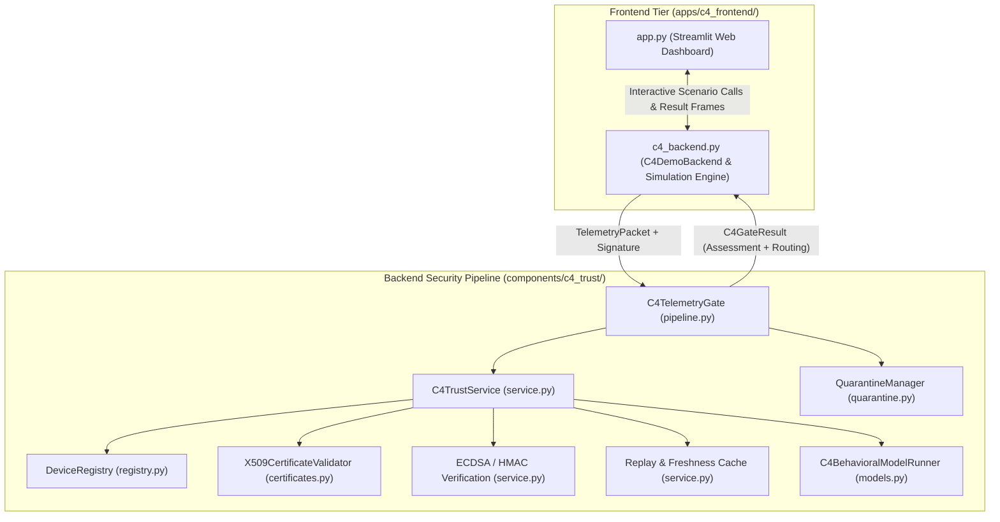
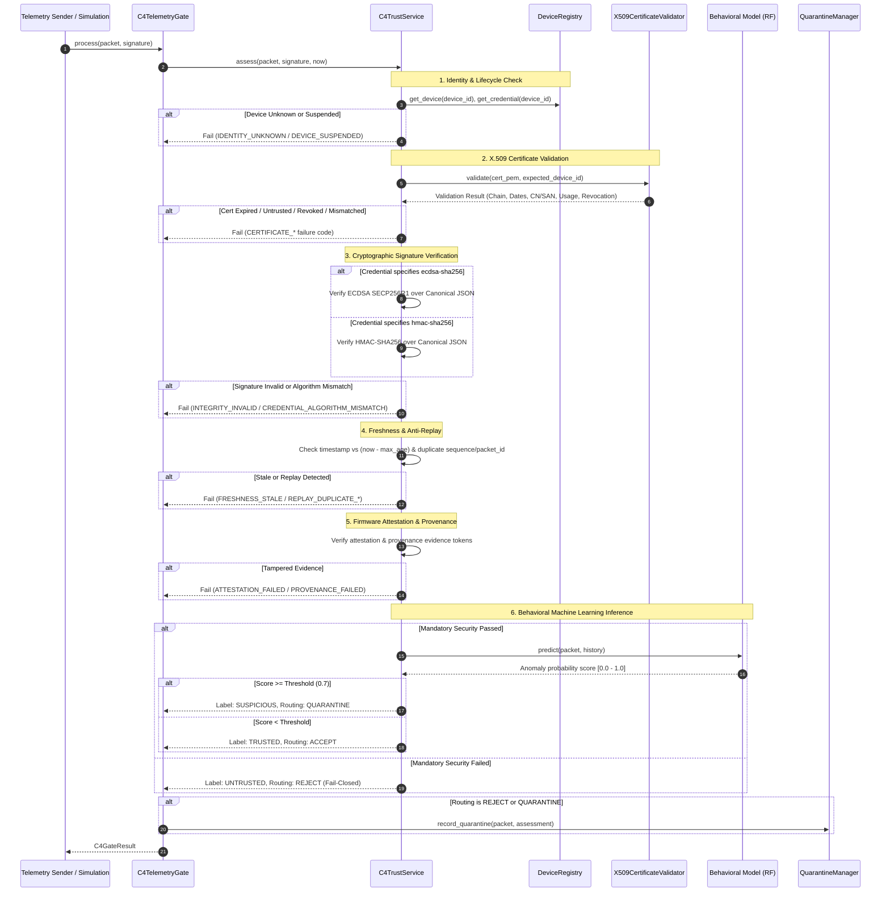

# GeoNex Component C4: Frontend and Backend Architecture & Features Guide

**Component C4: Trusted Telemetry, Provenance and Device Attestation**  
**SLIIT IT4010 Research Project — GeoNex Security Operations**

---

## 1. System Overview & Architecture

GeoNex Component C4 serves as the **Zero-Trust Security Gate** for all telemetry entering the GeoNex platform. Every sensor telemetry packet must undergo strict deterministic cryptographic verification, hardware and provenance attestation, and behavioral machine learning (ML) anomaly detection before it is permitted into Component C1 (Core Processing Pipeline).

The C4 system is organized into two primary tiers:
1. **Backend Core & Verification Pipeline (`components/c4_trust/`)**: The modular, fail-closed security enforcement engine.
2. **Frontend Security Operations Center (`apps/c4_frontend/`)**: A Streamlit-based interactive dashboard and simulation backend (`c4_backend.py`) allowing security analysts to inspect real-time packets, trigger cyberattack simulations, and audit cryptographic evidence.



---

## 2. Backend Architecture: How the Security Pipeline Works

The backend follows a **strict fail-closed evaluation pipeline**. Mandatory security checks are evaluated in descending order of trust dependency. **A failure at any mandatory check immediately disqualifies the packet from C1 routing and cannot be overridden by ML scores.**

### 2.1 The Decision Pipeline Sequence



### 2.2 Core Backend Modules

#### 1. Device Registry (`registry.py`)
- Tracks authorized devices (`GNX-A01`, `GNX-B01`, etc.) and their lifecycle states:
  - `ACTIVE`: Fully authorized to transmit.
  - `SUSPENDED`: Temporarily halted; packets fail verification.
  - `REVOKED`: Permanently untrusted.
  - `DECOMMISSIONED`: Retired from service.
- Stores `DeviceCredential`:
  - `credential_id`: Unique identifier for key rotation.
  - `signature_algorithm`: `ecdsa-sha256` or `hmac-sha256`.
  - `public_key_pem`: The ECDSA EC public key (auto-extracted from certificate if supplied).
  - `secret`: Symmetric HMAC key (when algorithm is HMAC).
  - `certificate_pem`: Registered X.509 device certificate.
- Maintains in-memory and database-backed revocation status.

#### 2. X.509 Certificate Validator (`certificates.py`)
- **Trust Anchor Verification**: Verifies that the device certificate was issued by an explicitly configured Root or Intermediate Certificate Authority (CA).
- **Temporal Validity**: Checks `not_before` and `not_after` against current verification time.
- **Identity Binding**: Strict match verifying that the certificate's `Common Name (CN)` or `Subject Alternative Name (SAN: DNS / URI)` matches the packet's `device_id`.
- **Key Usage Constraints**: Verifies that the `KeyUsage` extension has `digital_signature = True` and that `is_ca = False` (rejects CA certificates masquerading as devices).
- **Self-Signed Rejection**: Explicitly rejects self-signed certificates unless they are an approved Root CA.
- **Revocation Checking**: Verifies certificate serial numbers against X.509 CRLs and the local registry revocation database.

#### 3. Canonical Packet Serialization & Signature Verification (`service.py`)
- To prevent signature mismatch between different platforms or JSON formatters, the packet is serialized into a deterministic canonical representation:
  ```python
  payload = json.dumps(
      packet.model_dump(mode="json", exclude={"security": {"integrity_present"}}),
      sort_keys=True,
      separators=(",", ":"),
      ensure_ascii=False,
  ).encode("utf-8")
  ```
- **ECDSA Verification**: Cryptographically validates the DER-encoded ECDSA signature using `cryptography.hazmat.primitives.asymmetric.ec.ECDSA(hashes.SHA256())`.
- **No Downgrade Attacks**: The algorithm used for verification is picked from `credential.signature_algorithm`, **never** from untrusted packet headers.

#### 4. Anti-Replay & Freshness (`service.py`)
- **Monotonic Sequence Enforcement**: Validates that incoming `sequence_no` increments correctly.
- **Sliding Window Cache**: Caches recent `packet_id`s within a configurable time window (`max_age_seconds=30s`).
- **Clock Skew Tolerance**: Future timestamp tolerance (`future_tolerance_seconds=5s`).

#### 5. Behavioral Machine Learning Engine (`models.py`, `runtime_features.py`)
- Features: 18 statistical and operational metrics extracted in real-time from the packet and recent historical windows (`RuntimeFeatureAdapter`).
- Model: Pre-trained scikit-learn `RandomForestClassifier` (`random_forest_corrected.joblib`).
- Role: Anomaly scoring. High anomaly scores (>= 0.70) trigger `SUSPICIOUS` status and route the packet to `QUARANTINE`.
- **Fail-Closed Guarantee**: An ML score of 0.0 (perfectly normal) **cannot** override an invalid signature or expired certificate.

#### 6. Quarantine Manager (`quarantine.py`)
- Safely isolates invalid, tampered, replayed, or suspicious packets.
- Persists isolated records to disk as JSON containing the full packet payload, raw signature, failure reason codes, timestamp, and isolation reason.

---

## 3. Frontend Architecture: Streamlit Security Operations Center

The frontend dashboard (`apps/c4_frontend/app.py`) provides an interactive interface for monitoring telemetry trust, running attack simulations, and conducting forensic investigations.

### 3.1 Workspace Pages

#### Page 1: Command Center (`Command Center`)
- **KPI Metric Banners**:
  - `Packets Assessed`: Total volume processed in the current session.
  - `Trusted`: Packets that cleared all mandatory checks and passed ML behavioral analysis.
  - `Accepted for C1`: Packets granted ingress to downstream operational processing.
  - `Untrusted`: Packets rejected due to mandatory security failures (identity, certificate, tampering).
  - `Suspicious / Unknown`: Packets flagged by ML behavioral anomalies.
  - `Quarantined`: Packets isolated to the quarantine repository.
- **Trust Distribution Chart**: Bar chart summarizing label breakdowns (`TRUSTED`, `UNTRUSTED`, `SUSPICIOUS`, `UNKNOWN`).
- **Routing Outcomes Chart**: Visual distribution of decisions (`ACCEPT`, `REJECT`, `QUARANTINE`).
- **Assessment Activity Line Chart**: Real-time trend graph of behavioral anomaly scores over the last 30 packets.
- **Live Stream Table**: Reverse-chronological table of recent packet assessments.

#### Page 2: Telemetry Explorer (`Telemetry Explorer`)
- **Multi-Dimensional Filtering**:
  - Filter by Device ID (`GNX-A01`, `GNX-B01`, etc.).
  - Filter by Trust Label (`TRUSTED`, `UNTRUSTED`, `SUSPICIOUS`, `UNKNOWN`).
  - Filter by Scenario (`Valid X.509 + ECDSA`, `Tampered ECDSA`, `Expired Certificate`, etc.).
- **Packet Inspection**: Select any individual packet to view:
  - Trust label, routing outcome, and behavioral score.
  - Specific reason codes emitted by the C4 trust gate.
  - **11-Point Security Audit Checklist**:
    1. Zone validation (`ZONE_*`)
    2. Hub validation (`HUB_*`)
    3. Device identity (`IDENTITY_*`)
    4. Certificate validation (`CERTIFICATE_*`)
    5. Credential ID (`CREDENTIAL_ID_*`)
    6. Credential verification (`CREDENTIAL_*`)
    7. Packet integrity (`INTEGRITY_*`)
    8. Device attestation (`ATTESTATION_*`)
    9. Telemetry provenance (`PROVENANCE_*`)
    10. Freshness validation (`FRESHNESS_*`)
    11. Replay protection (`REPLAY_*`)

#### Page 3: Threat Investigation (`Threat Investigation`)
- **Incident Summary Banners**:
  - `Flagged Assessments`: Total packets requiring security review.
  - `Integrity Failures`: Count of cryptographic signature / tampering failures.
  - `Replay Detections`: Count of detected replay attempts.
- **Incident Reason Frequency Chart**: Bar chart identifying top failure reasons (e.g., `CERTIFICATE_EXPIRED`, `INTEGRITY_INVALID`, `REPLAY_DUPLICATE_PACKET_ID`).
- **Forensic Drill-Down**: Deep inspection of quarantined and rejected packets with complete security audit evidence.

#### Page 4: ML Model Explorer (`ML Model Explorer`)
- **Artifact catalog**: Inspect `random_forest_corrected.joblib` (runtime default) plus baseline Random Forest, Logistic Regression, and Isolation Forest.
- **Schema and importance**: Exact 18-feature `C4_MODEL_FEATURE_SCHEMA`, impurity/coefficient importance, and family-level (B0–B5) contribution.
- **Holdout evaluation**: Score `C4_test_corrected.csv` or `C4_test.csv`, including accuracy and confusion matrix.
- **Sample inspector and what-if scoring**: Review individual holdout packets and rescore edited behavioral features against the 0.70 anomaly threshold.
- **SHAP plots**: Display offline explanations from `experiments/c4/plots/` generated by `scripts/explain_c4_model.py`.
- See `C4_ML_MODEL_EXPLORER.md` for the full explorer guide.

#### Page 5: Model & Policy (`Model & Policy`)
- **Behavioral Model Profile**: Random Forest classifier details, 18 runtime features schema, decision thresholds.
- **Security Policy Table**: Outlines configured mechanisms for all 9 mandatory controls.
- **Research Disclaimers**: Clarifies test PKI vs. hardware TPM production environments.

---

## 4. Simulation Backend (`apps/c4_frontend/c4_backend.py`)

The simulation backend bridges the frontend UI with the production C4 pipeline without exposing sensitive keys or requiring external hardware devices.

### 4.1 Test PKI & In-Memory Key Management
When the backend initializes:
1. It creates an in-memory test **Root Certificate Authority (CA)**:
   ```python
   self._ca_key, self._ca_cert, self._ca_cert_pem = create_ca(
       common_name="GeoNex Demo Test Root CA"
   )
   ```
2. For each simulated device (`GNX-A01`, `GNX-B01`, etc.):
   - Generates a dedicated SECP256R1 EC private key.
   - Issues an X.509 device certificate signed by the Root CA with `CN=<device_id>` and `digital_signature=True`.
   - Registers the certificate and public key into the `DeviceRegistry`.
   - Retains the private key **strictly on the sender side** to generate packet signatures.

### 4.2 Built-In Simulation Scenarios

The sidebar in `app.py` triggers the following scenarios through `c4_backend.py`:

| Scenario Button | Backend Routine | What It Simulates | Expected Outcome |
| :--- | :--- | :--- | :--- |
| **Run Valid Telemetry (HMAC)** | `valid_hmac` | Standard telemetry signed with registered HMAC-SHA256 symmetric key. | `TRUSTED` / `ACCEPT` |
| **Test Tampered (HMAC)** | `tampered_hmac` | Telemetry payload modified in transit after HMAC signature creation. | `UNTRUSTED` / `REJECT` (`INTEGRITY_INVALID`) |
| **Test Replay Attack (HMAC)** | `replay_hmac` | Same valid HMAC packet transmitted twice with identical sequence and ID. | 1st: `ACCEPT`<br>2nd: `REJECT` (`REPLAY_DUPLICATE_PACKET_ID`) |
| **Run Valid X.509 + ECDSA** | `valid_ecdsa` | Telemetry carrying valid X.509 device certificate and ECDSA-SHA256 signature. | `TRUSTED` / `ACCEPT` (`CERTIFICATE_VALID`, `INTEGRITY_VALID`) |
| **Test Tampered (ECDSA)** | `tampered_ecdsa` | Sensor reading or zone modified after ECDSA private-key signing. | `UNTRUSTED` / `REJECT` (`INTEGRITY_INVALID`) |
| **Test Expired Certificate** | `expired_x509` | Device certificate generated with validity dates in the past. | `UNTRUSTED` / `REJECT` (`CERTIFICATE_EXPIRED`) |
| **Test Untrusted CA** | `untrusted_ca_x509` | Device certificate signed by a rogue, unrecognized Root CA. | `UNTRUSTED` / `REJECT` (`CERTIFICATE_UNTRUSTED_ISSUER`) |
| **Test Identity Mismatch Cert** | `mismatched_identity_x509` | Legitimate CA certificate issued for `GNX-A01` attached to packet for `GNX-B01`. | `UNTRUSTED` / `REJECT` (`CERTIFICATE_IDENTITY_MISMATCH`) |
| **Test Revoked Certificate** | `revoked_x509` | Device marked as `REVOKED` in the registry. | `UNTRUSTED` / `REJECT` (`DEVICE_SUSPENDED` / `CERTIFICATE_REVOKED`) |
| **Test Alg Fallback Rejection** | `fallback_rejection` | Attacker attempts to forge HMAC signature on a device registered for ECDSA. | `UNTRUSTED` / `REJECT` (`CREDENTIAL_ALGORITHM_MISMATCH`) |

---

## 5. Security Reason Codes Reference

The C4 gate attaches auditable reason codes to every assessment record:

| Category | Reason Code | Description |
| :--- | :--- | :--- |
| **Certificate** | `CERTIFICATE_VALID` | Certificate chained to trusted CA, within validity dates, identity matches, key usage valid. |
| | `CERTIFICATE_EXPIRED` | Certificate current time is after `not_after`. |
| | `CERTIFICATE_NOT_YET_VALID` | Certificate current time is before `not_before`. |
| | `CERTIFICATE_UNTRUSTED_ISSUER` | Certificate issuer is not among trusted CA certificates. |
| | `CERTIFICATE_IDENTITY_MISMATCH` | Certificate `CN` or `SAN` does not match packet `device_id`. |
| | `CERTIFICATE_KEY_USAGE_INVALID` | `KeyUsage` extension missing `digital_signature = True`. |
| | `CERTIFICATE_REVOKED` | Certificate found in CRL or registry revocation table. |
| | `CERTIFICATE_MALFORMED` | PEM string cannot be parsed as an X.509 certificate. |
| **Integrity** | `INTEGRITY_VALID` | Signature cryptographically matches canonical packet payload. |
| | `INTEGRITY_INVALID` | Signature verification failed (payload tampered or wrong key). |
| | `CREDENTIAL_ALGORITHM_MISMATCH`| Provided signature algorithm does not match registered algorithm. |
| | `SIGNATURE_MISSING` | Required signature was not provided in the packet. |
| **Replay / Fresh** | `FRESHNESS_VALID` | Packet timestamp within acceptable age bounds. |
| | `FRESHNESS_STALE` | Packet older than `max_age_seconds` (30s). |
| | `REPLAY_DUPLICATE_PACKET_ID` | `packet_id` already processed within current history window. |
| **Behavioral ML** | `BEHAVIORAL_NORMAL` | Random Forest anomaly score below threshold (< 0.70). |
| | `BEHAVIORAL_ANOMALY_DETECTED` | Random Forest anomaly score at or above threshold (>= 0.70). |
| **Lifecycle** | `IDENTITY_VALID` | Device registered and in `ACTIVE` state. |
| | `DEVICE_SUSPENDED` | Device lifecycle state is `SUSPENDED` or `REVOKED`. |

---

## 6. How to Run the System

### 6.1 Start the Frontend Dashboard
Open Windows PowerShell, navigate to the project directory, and execute:

```powershell
cd C:\Users\User\Desktop\FInal_GeoNex_Repo\J26-IT-331
streamlit run apps/c4_frontend/app.py
```
*The web UI will open automatically at `http://localhost:8501`.*

### 6.2 Execute Automated Backend Test Suites
To verify all backend and security controls from PowerShell:

```powershell
# 1. Run X.509 and ECDSA tests (14 tests)
pytest tests/security/test_c4_x509_certificates.py -v

# 2. Run all C4 security tests (92 tests)
pytest tests/security/ -v

# 3. Run the complete repository test suite (271 tests)
pytest

# 4. Run static lint and code quality check
ruff check components/c4_trust/ apps/c4_frontend/ tests/security/ shared/
```
