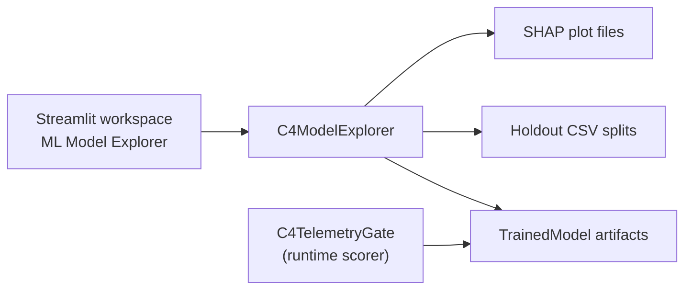

# GeoNex C4 Machine Learning Model Explorer

**Component C4: Trusted Telemetry, Provenance and Device Attestation**  
**SLIIT IT4010 Research Project — GeoNex Security Operations**

This document describes the Machine Learning Model Explorer that is integrated into the existing GeoNex C4 Streamlit frontend.

---

## 1. Purpose

C4 combines two decision layers:

1. **Mandatory security** — identity, X.509 certificates, ECDSA/HMAC integrity, freshness, replay, attestation, and provenance. A failure here always rejects the packet.
2. **Behavioral machine learning** — an 18-feature Random Forest that scores residual behavioral risk only after mandatory checks pass.

The Model Explorer lets analysts inspect the second layer without treating ML as a security override. It is a workspace page inside `apps/c4_frontend/app.py`, not a separate application.

---

## 2. Where It Lives

| Path | Role |
| :--- | :--- |
| `apps/c4_frontend/app.py` | Existing Security Operations Center. Adds the **ML Model Explorer** workspace page. |
| `apps/c4_frontend/ml_explorer.py` | Model catalog, schema validation, holdout scoring, feature importance. |
| `apps/c4_frontend/ml_explorer_ui.py` | Streamlit UI for the explorer page. |
| `apps/c4_frontend/c4_backend.py` | Live simulation backend. Continues to load `random_forest_corrected.joblib`. |
| `experiments/c4/models/` | Serialized `TrainedModel` artifacts. |
| `experiments/c4/data/` | Train/validation/test splits, including corrected files. |
| `experiments/c4/plots/` | Offline SHAP plots from `scripts/explain_c4_model.py`. |



The live Command Center still scores simulated packets through `C4TelemetryGate`. The Model Explorer inspects the same artifact family used by that gate.

---

## 3. How To Open It

From PowerShell:

```powershell
cd C:\Users\User\Desktop\FInal_GeoNex_Repo\J26-IT-331
streamlit run apps/c4_frontend/app.py
```

In the sidebar, open **WORKSPACE → ML Model Explorer**.

The default artifact is **Random Forest (corrected, runtime)** — the same file used by `C4DemoBackend`:

```
experiments/c4/models/random_forest_corrected.joblib
```

---

## 4. Workspace Tabs

### 4.1 Profile & Schema

Shows:

- Model type, class labels (`Trusted`, `Suspicious`, `Untrusted`)
- Feature count (must be 18)
- Whether the artifact is the runtime scorer
- Stored validation metrics if present in the joblib
- The exact `C4_MODEL_FEATURE_SCHEMA` order with behavioral family tags (B0–B5)

A schema mismatch raises `ModelSchemaError` and the page reports the failure instead of scoring.

### 4.2 Feature Importance

- Random Forest: impurity-based `feature_importances_`
- Logistic Regression: mean absolute coefficients
- Isolation Forest: no calibrated importance (the page states this)

Importance is also aggregated by behavioral family so analysts can see whether timing, radio, health, or historical windows dominate.

### 4.3 Holdout Evaluation

Scores the catalog holdout file:

| Artifact | Holdout file |
| :--- | :--- |
| `random_forest_corrected.joblib` | `C4_test_corrected.csv` |
| `random_forest.joblib` | `C4_test.csv` |
| `logistic_regression.joblib` | `C4_test.csv` |
| `isolation_forest.joblib` | `C4_test.csv` |

The page reports accuracy, class counts, and a confusion matrix. This is offline model quality, not a live C4 gate decision.

### 4.4 Sample Inspector

A class-balanced sample of holdout rows. Selecting a packet shows:

- True label vs predicted label
- Class probabilities
- Behavioral anomaly score `1 - P(Trusted)`
- The 18 feature values used for that prediction

### 4.5 What-If Scoring

Starts from a Trusted holdout row and lets you move key features:

- `tx_interval_s`
- `rssi_dbm`
- `snr_db`
- `retry_count`
- `battery_pct`
- `rolling_interval_std`
- `rolling_rssi_mean`

The explorer rescores immediately and compares the anomaly score with the runtime threshold **0.70**. Isolation Forest is excluded because C4 does not use it as a calibrated trust score.

### 4.6 SHAP Plots

Displays research plots already produced by:

```powershell
python scripts/explain_c4_model.py
```

Expected files:

- `experiments/c4/plots/shap_bar.png`
- `experiments/c4/plots/shap_summary.png`
- `experiments/c4/plots/shap_force_example_1.png`
- `experiments/c4/plots/shap_force_example_2.png`
- `experiments/c4/plots/shap_force_example_3.png`

These are offline explanations. They are not live SHAP values for dashboard simulation packets.

---

## 5. Runtime Contract

The explorer enforces the same 18-feature schema as `RuntimeFeatureAdapter`:

1. `tx_interval_s`
2. `rx_delay_s`
3. `freshness_status_encoded`
4. `rssi_dbm`
5. `rssi_deviation_db`
6. `snr_db`
7. `retry_count`
8. `packet_size_bytes`
9. `battery_pct`
10. `battery_voltage_v`
11. `current_ma`
12. `reboot_count_24h`
13. `sensor_fault_flag`
14. `rolling_interval_mean`
15. `rolling_interval_std`
16. `rolling_rssi_mean`
17. `rolling_rssi_std`
18. `rolling_retry_mean`

Security fields such as `signature_valid`, `cert_registered`, and `attestation_passed` are excluded. That prevents the model from leaking deterministic cryptographic outcomes.

Fail-closed rules still apply in the live gate:

- Invalid signature, expired certificate, replay, or unknown identity → `UNTRUSTED` / `REJECT`
- ML cannot accept a packet that failed those checks
- ML can only mark an otherwise valid packet `SUSPICIOUS` and route it to quarantine when the anomaly score is at least 0.70

---

## 6. Tests

```powershell
cd C:\Users\User\Desktop\FInal_GeoNex_Repo\J26-IT-331
pytest tests/unit/c4/test_c4_ml_explorer.py -v
```

The tests cover:

- Schema rejection for incomplete holdout files
- Scoring, importance, and sample inspection on a tiny Random Forest
- Catalog default pointing at the corrected runtime artifact when it is present

---

## 7. Related Documents

- `C4_FRONTEND_AND_BACKEND_GUIDE.md` — full C4 dashboard and pipeline
- `docs/components/C4_RUNTIME_INTEGRATION_SUMMARY.md` — runtime ML wiring
- `docs/components/C4_README.md` — component overview
- `scripts/explain_c4_model.py` — offline SHAP generation
